<p align="center">
  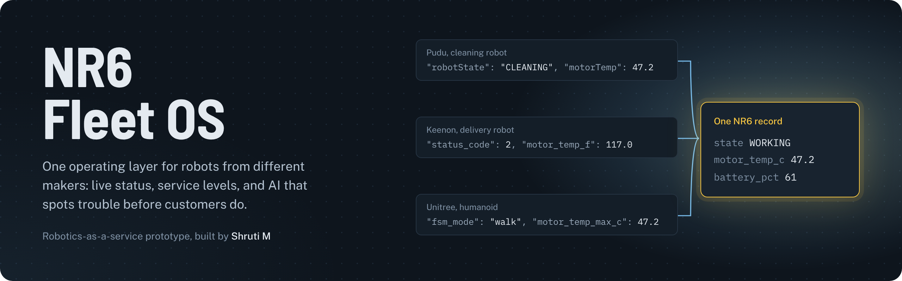
</p>

Every company with machines, sensors or devices from more than one supplier has the same problem: each one describes the world in its own way. This project tackles that problem in a setting where it really bites, a fleet of robots rented out as a service.

A cleaning robot from Pudu, a delivery robot from Keenon and a humanoid from Unitree each report their status in a different format. One gives its temperature in Fahrenheit, another sends its battery as a fraction. NR6 Fleet OS translates them all into one shared record, then builds on that foundation: a database and SQL metrics, live service-level tracking for each customer, a model of the money each robot makes or loses, and three kinds of AI. A machine-learning model predicts faults, an anomaly detector catches problems nobody trained it for, and a language-model assistant answers questions using only the fleet's own numbers.

The result is both a working system and an answer: the business works, but only if the robots are reliable. In the sample fleet, one humanoid robot loses more money each month than the other eight make together.

**Try it live: [nr6-fleet-os.streamlit.app](https://nr6-fleet-os.streamlit.app)**

<sub>All data is simulated and customer names are made up. If the app has been idle, click the button to wake it; it takes about a minute.</sub>

<p align="center">
  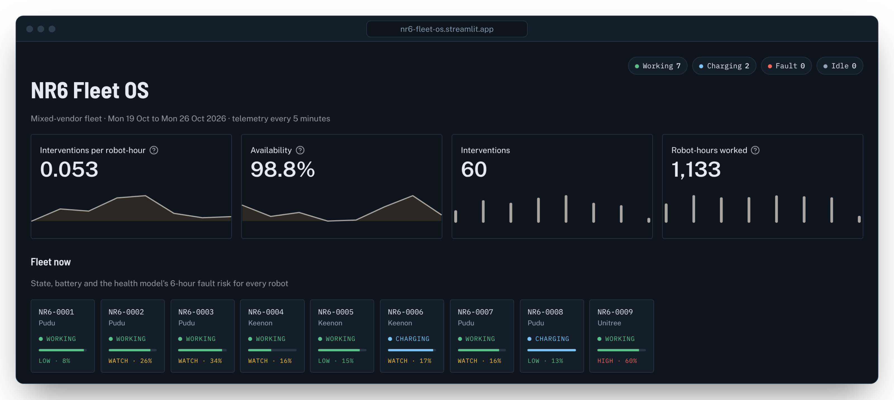
</p>

## What it does

### One language for every robot

Each brand gets a small adapter that translates its messages into one NR6 record. Here a Keenon delivery robot reports its battery as `0.93` and its motor temperature as `112.3` in Fahrenheit. NR6 stores `93` and `44.6 °C`, exactly as it would for any other brand. Everything after this point (the database, the metrics, the AI) works the same for every robot, so adding a new brand means writing one adapter, not rebuilding the system. Automated tests check that all three brands produce identical records.

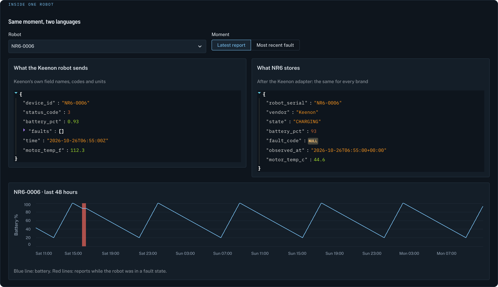

### Is every customer getting what they paid for?

Each robot belongs to a site, and each site to a customer with an agreed uptime target. This page compares the promise with what the robots delivered. Three of four sites are on target. The humanoid pilot site missed its 96% target at 94.4%, and the page shows which robot caused it.

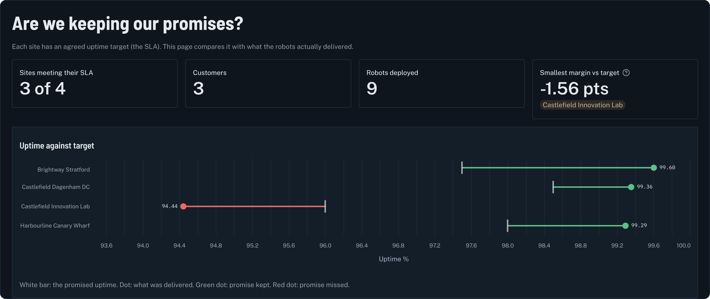

### Does each robot make money?

A model of the monthly subscription fee, running costs, engineer visits and depreciation for every robot, with assumptions you can change. With the default settings, the sample fleet loses £360 a month, almost all of it from the humanoid. The curve on the right shows the real lever: if robots needed a person around 15% less often, the fleet would break even.

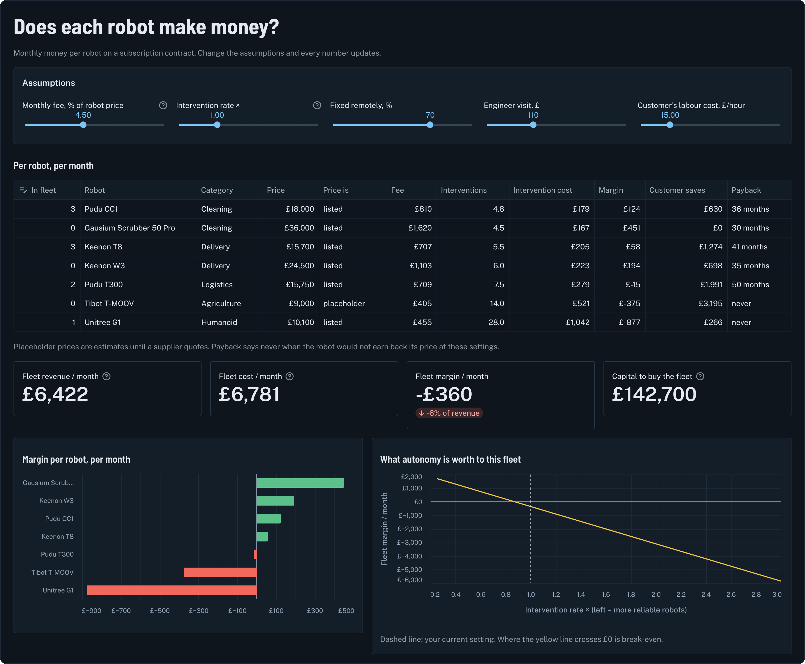

### Three kinds of AI

Each one answers a different question, and they are designed to work together.

#### Which robot is likely to fail next?

A machine-learning model trained on a month of history estimates each robot's chance of a new fault in the next six hours, using motor temperature, recent faults and brand. It scores 0.82 AUC on a week of data it never saw during training. Each prediction comes with a plain reason an engineer can check, such as "motor running hot".

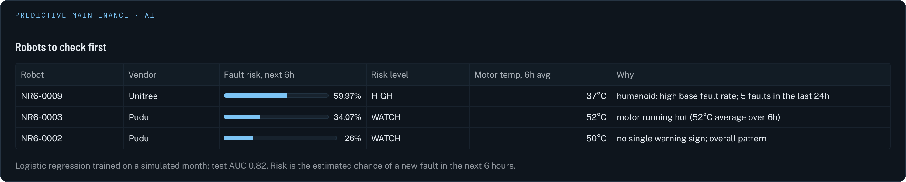

#### Is anything behaving strangely?

The prediction model can only recognise problems it has learned from. This detector needs no history of faults at all: it compares every robot with its own normal behaviour over the previous three days. To test it, I planted a hidden battery fault in one robot without telling the rest of the system. It was flagged within an hour, with no false alarms on the other eight robots, while the prediction model rated the same robot at only 16% risk.

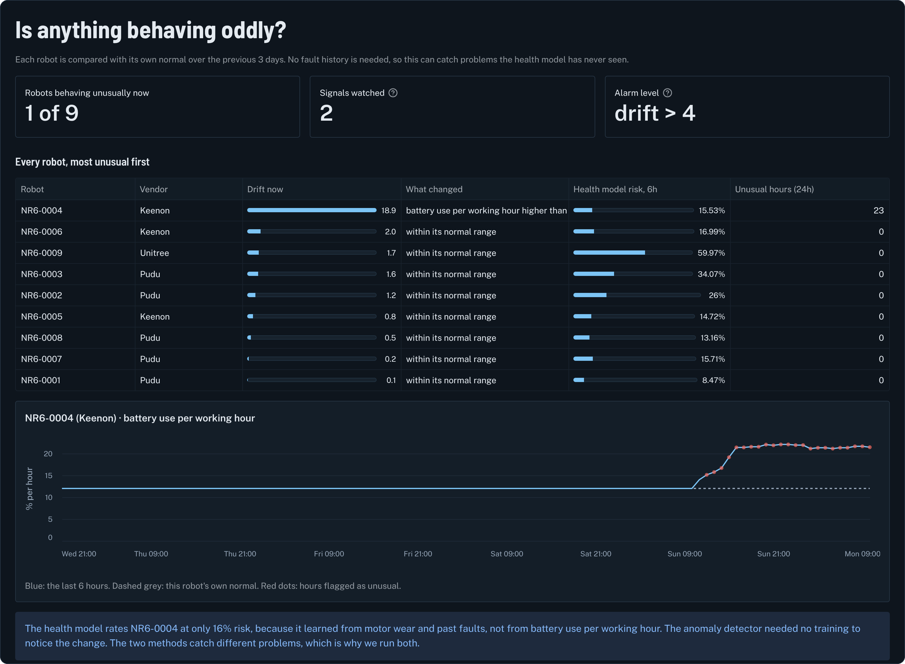

#### Can I just ask?

A language-model assistant answers questions in plain English. It only sees the fleet facts the system gives it, it is told to say when the answer isn't there, and a panel shows exactly what it was shown. The AI provider can be swapped with one setting, in the same way each robot brand has its own adapter.

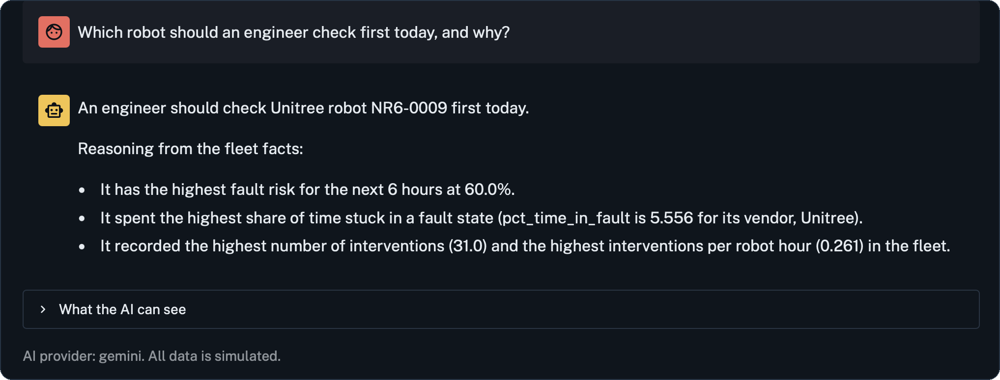

## What the data showed

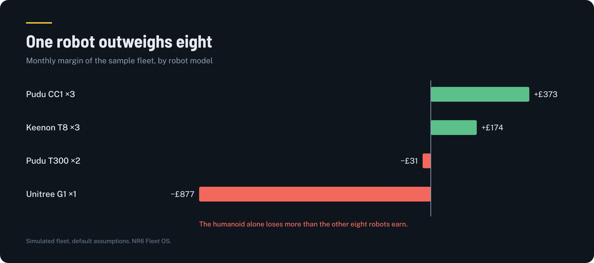

**One robot outweighs eight.** Reliability decides whether this business makes money. If robots needed a person around 15% less often, the fleet would break even, and that is a better lever than raising prices.

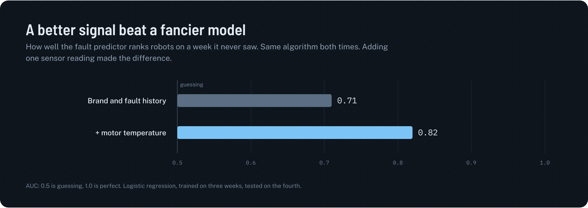

**A better signal beat a fancier model.** My first fault predictor only knew each robot's brand and fault history, and scored 0.71. Rather than reach for a more complex algorithm, I added a signal that actually changes before a breakdown: motor temperature. The same simple model jumped to 0.82.

**Two kinds of AI catch different problems.** A planted battery fault was invisible to the prediction model (16% risk) but caught by the anomaly detector within an hour. Running both is not duplication; each covers the other's blind spot.

**AI is only as good as its data definitions.** The assistant once described a past figure as a prediction, because a column name was vague. Renaming the column and defining every field in its instructions fixed it. This is the least visible part of building AI, and one of the most important.

## How it fits together

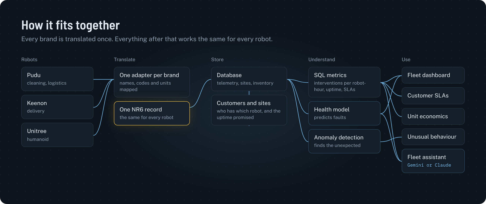

<details>
<summary><b>Where each part lives in the code</b></summary>

| Part | File |
|---|---|
| Robot and customer data | `data/catalogue.yaml`, `data/customers.yaml` |
| Simulator | `src/nr6/sim/` |
| Adapters and the common record | `src/nr6/adapters/` |
| Pipeline, database, sites | `src/nr6/pipeline.py`, `src/nr6/db.py`, `src/nr6/sites.py` |
| Metrics (SQL) | `src/nr6/metrics/fleet_metrics.py` |
| Unit economics | `src/nr6/economics.py` |
| Fault prediction | `src/nr6/health_model.py` |
| Anomaly detection | `src/nr6/anomaly.py` |
| AI provider switch and assistant | `src/nr6/llm.py`, `src/nr6/assistant.py` |
| App pages | `app/` |
| Tests | `tests/` |

</details>

## Decisions I made

<details>
<summary><b>Why every brand is translated into one record first</b></summary>
<br>

The alternative is to build each report, alert and model once per brand, which multiplies the work every time a new supplier is added. Instead, each brand gets a small adapter, and everything after it only ever sees one NR6 record. Adding a brand means writing one adapter. Automated tests feed the same moment through all three adapters and check that the records match, so a change to one brand can't quietly break the others.

</details>

<details>
<summary><b>Why the fault predictor is a simple model</b></summary>
<br>

I used logistic regression on purpose. Its predictions are easy to explain to an engineer, and the model is quick to retrain. I split the data by time (three weeks to train, the fourth to test) so the model was never tested on days it had already seen. When the first version scored only 0.71, the fix wasn't a more complex algorithm; it was a better signal. Adding motor temperature lifted it to 0.82.

</details>

<details>
<summary><b>Why the anomaly detector compares each robot with itself</b></summary>
<br>

Different brands behave differently, so comparing a humanoid with a cleaning robot says little. Each robot is compared with its own previous three days instead. I used the median rather than the average, so a single odd hour can't distort what counts as normal. I judged it the way you judge any detector: how quickly it notices a real problem, and how often it raises a false alarm. On a planted battery fault it took one hour, with no false alarms.

</details>

<details>
<summary><b>Why the assistant only sees what the system gives it</b></summary>
<br>

A language model will happily make up numbers if you let it. Here it receives a fixed set of fleet facts with every question, a definition for every column, and an instruction to say when the answer isn't in the facts. A panel on the page shows exactly what it was given. The provider sits behind one switch, so moving from Gemini to Claude, or to a private model for real customer data, is a settings change rather than a rewrite.

</details>

<details>
<summary><b>Why the data is simulated, and what that means</b></summary>
<br>

There was no real fleet to connect to yet, so I built a simulator with the behaviour that matters: robots wear over time, worn motors run hotter, hot motors fault more often, and each brand reports in its own format. The structure of the system is real; the numbers are illustrations. The prediction model in particular would need retraining on real fault data before anyone relied on it.

</details>

## From prototype to production

The design carries over: the common record, the adapter pattern, the metric definitions, the economics model and the AI approach. A production version would also need live connections to each vendor's data feed (worth checking with suppliers before buying robots), a time-series database in place of a single file, logins and separate data for each customer, engineer work orders raised automatically from high-risk and unusual robots, connections to ticketing and billing, and the fault model retrained on real data. Open-source fleet tools and emerging robot data standards, such as Open-RMF and the upcoming ISO 21423, are worth evaluating before building that layer from scratch.

<details>
<summary><b>Run it on your own computer</b></summary>
<br>

```bash
git clone https://github.com/shruti154/nr6-fleet-os.git
cd nr6-fleet-os
python -m venv .venv
source .venv/bin/activate
pip install -r requirements.txt
streamlit run app/dashboard.py
```

The fleet assistant needs a free Gemini API key in `.streamlit/secrets.toml`:

```toml
AI_PROVIDER = "gemini"
GEMINI_API_KEY = "your-key"
GEMINI_MODEL = "your-model-name"
```

Run the tests with `pytest -q`.

</details>

---

<sub>Built by Shruti M · Python, DuckDB, scikit-learn, Streamlit, Gemini</sub>

© 2026 Shruti M. All rights reserved
